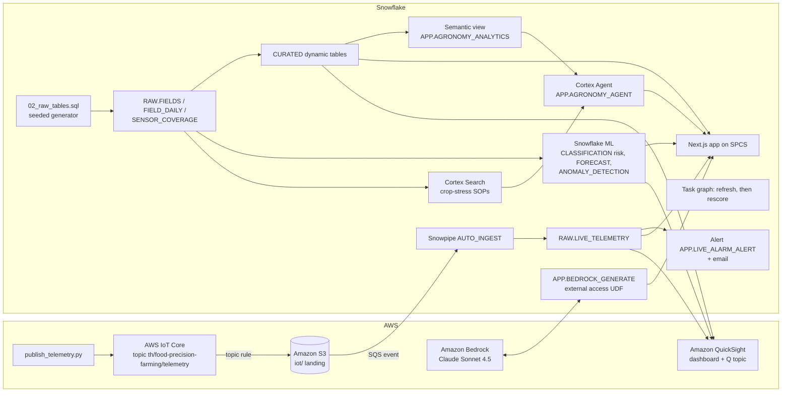

# Thailand Precision Farming - Field Crop Agronomy

Field-level crop agronomy for a **fictional Thai crop grower with 30 synthetic fields in Khon Kaen, Nakhon Sawan, Chiang Rai and Chanthaburi provinces**, growing jasmine rice, sugarcane, cassava, maize and durian. It is built on Snowflake with an optional AWS edge. A field sensor alarm becomes a 7-day crop-stress risk score, an email to the field agronomist and an AI-drafted action memo. The grower, fields, people and figures are invented; nothing here describes the yields, practices or compliance of any real company or farm.

## Architecture

The Snowflake core uses Dynamic Tables, Snowflake ML, Cortex Search, a Cortex Agent, Cortex AI_COMPLETE and SPCS; the full build adds **AWS** IoT Core, S3, Bedrock Claude and QuickSight with Amazon Q. Field-sensor readings land in `RAW.LIVE_TELEMETRY`. Dynamic tables curate 90 days of field-day history into plant health rate, crop-stress events, harvested tonnes, fertilizer intensity, pest alerts, sensor uptime and mapped-area coverage. Snowflake ML ranks fields by 7-day crop-stress risk, forecasts the grower's daily harvest and flags unusual soil moisture deficit days. The Cortex Agent answers with SQL and SOP citations, and an LLM drafts the action memo for the farm operations team.

Interactive diagrams (hover for object names): [Snowflake only](docs/architecture-snowflake.html) | [AWS + Snowflake](docs/architecture-aws.html). The app shows both on its Architecture & Data tab, the current build first. Regenerate them with `python3 docs/build_architecture.py`.



The Snowflake-only build drops the AWS subgraph: `APP.SIMULATE_TELEMETRY` writes to `RAW.LIVE_TELEMETRY`, and the app calls Cortex `AI_COMPLETE` instead of the Bedrock UDF.

## Snowflake Capabilities

| Capability | Implementation |
|-----------|---------------|
| Dynamic Tables | `CURATED.KPI_SUMMARY`, `PERFORMANCE_SUMMARY`, `CROP_STRESS_CAUSES`, `TREND_ANALYSIS` from the RAW tables |
| Snowflake ML | CLASSIFICATION 7-day crop-stress risk (`ML.CROP_STRESS_RISK_SCORES`), 14-day crop harvest FORECAST, soil moisture deficit ANOMALY_DETECTION |
| Cortex Search | 21 synthetic crop-stress response SOPs (one per crop and cause) in `SEARCH.AGRONOMY_SOP_SEARCH` |
| Semantic View | `APP.AGRONOMY_ANALYTICS` over fields, crop-stress causes, daily totals and risk |
| Cortex Agent | `APP.AGRONOMY_AGENT`: Cortex Analyst over the semantic view plus Cortex Search for SOP citations |
| Cortex AI | `AI_COMPLETE('claude-sonnet-4-5')` for grounded answers, and for the action memo in the Snowflake-only build |
| Alerts + Tasks | `APP.LIVE_ALARM_ALERT` logs ALARM readings and sends email; task graph `TASK_REFRESH_CURATED`, then `TASK_RESCORE_RISK` |
| Snowpark Container Services | Next.js app `APP.TH_FOOD_PRECISION_FARMING_APP` with 6 tabs: Executive Cockpit, Predictive, Field Health, Live IoT, Ask AI, Architecture & Data |
| Snowpipe | `RAW.LIVE_TELEMETRY_PIPE` AUTO_INGEST from S3 (AWS build only) |

## AWS Services

Used only in the AWS + Snowflake build.

| Service | Role in Demo |
|---------|-------------|
| AWS IoT Core | Receives simulated field-sensor telemetry (soil moisture deficit, irrigation canal level). A topic rule writes each message to S3 |
| Amazon S3 | Landing bucket. An event notification goes to the Snowpipe SQS queue |
| Amazon Bedrock | Claude Sonnet 4.5 writes the action memo, called from Snowflake through an external-access UDF |
| Amazon QuickSight | DIRECT_QUERY executive dashboard over Snowflake (daily plant health rate, crop-stress events by field, crop-stress risk) |
| Amazon Q | Natural-language questions over the QuickSight topic `th-food-precision-farming-topic` |
| AWS IAM | Least-privilege roles for S3, IoT and Bedrock |

## Personas

Both personas are fictional.

| Persona | Role | Key Questions |
|---------|------|---------------|
| **Siriporn Wattanakul** | VP Farm Operations | "Which province trails on plant health rate?" "Which crop-stress causes leave the most stressed plants?" |
| **Anucha Boonmee** | Field Agronomist | "Which fields carry high crop-stress risk this week, and which SOP do I follow?" |

## Data

Every row is synthetic and HASH-seeded, so a rebuild reproduces it exactly. Grower and field names are invented; Khon Kaen, Nakhon Sawan, Chiang Rai and Chanthaburi are real Thai provinces used only as region labels. Thresholds are demo settings rather than agronomic standards, and no figure is a field recommendation.

| Table | Rows | Description |
|-------|------|-------------|
| RAW.FIELDS | 30 | Fields across 4 provinces and 5 crops (Jasmine Rice, Sugarcane, Cassava, Maize, Durian Orchard), with area and years under continuous cropping |
| RAW.FIELD_DAILY | 2,700 | Daily field observations over 90 days: plants scouted and recorded healthy, harvested tonnes, fertilizer kg, pest alerts, crop-stress events, root cause, scouting rounds, sensor downtime, soil moisture deficit and irrigation canal level |
| RAW.SENSOR_COVERAGE | 30 | Field hectares and hectares covered by sensor and drone mapping |
| SEARCH.AGRONOMY_SOP_DOCS | 21 | Synthetic crop-stress response SOPs indexed for Cortex Search |
| RAW.LIVE_TELEMETRY | Grows during the demo | Live readings from IoT Core (AWS build) or `APP.SIMULATE_TELEMETRY` (Snowflake-only build) |
| ML.CROP_STRESS_RISK_SCORES | 30 | 7-day crop-stress probability and risk band per field |

## Build Instructions

### Prerequisites
- Snowflake account with ACCOUNTADMIN access, and Cortex AI enabled (AI_COMPLETE, Search, Agent).
- An X-Small warehouse with auto-suspend at or below 120 s, and an existing SPCS compute pool.
- Python 3.11+, `snowflake-connector-python`, Node.js 22+, Docker and the `snow` CLI.
- App image: run `snow spcs image-registry login`, then build and push `th-food-precision-farming-app:v1` to the database's `APP.IMAGES` repository (see the header of `snowflake/07_deploy_app.sql`).
- AWS build only: `boto3`, AWS credentials for the target account (us-west-2) with Bedrock access, and QuickSight Enterprise.

### SPCS App
```
<DATABASE>.APP.TH_FOOD_PRECISION_FARMING_APP
```

### Tests
```bash
python -m pytest aws snowflake quicksight
```

For a local run, put `SNOWFLAKE_ACCOUNT`, `SNOWFLAKE_USER`, `SNOWFLAKE_DATABASE`, `SNOWFLAKE_WAREHOUSE`, `SNOWFLAKE_AUTHENTICATOR=PROGRAMMATIC_ACCESS_TOKEN`, `SNOWFLAKE_TOKEN` and `DEMO_PLATFORM` in the environment, then run `npm --prefix app run build && npm --prefix app start`.

## Build Modes

Both modes share the same core. They differ in three places, and the app's `DEMO_PLATFORM` setting (in its SPCS spec) switches the memo provider and the Live IoT tab.

| Layer | Snowflake Only | Full AWS + Snowflake |
|---|---|---|
| Live telemetry | `CALL APP.SIMULATE_TELEMETRY(n)` inserts simulated readings into `RAW.LIVE_TELEMETRY`. This simulates a sensor feed; it is not Snowpipe Streaming | `aws/publish_telemetry.py` to AWS IoT Core, then S3, SQS and Snowpipe AUTO_INGEST |
| Action memo | Cortex `AI_COMPLETE('claude-sonnet-4-5')` | Amazon Bedrock Claude Sonnet 4.5 through `APP.BEDROCK_GENERATE` |
| BI and natural-language questions | The SPCS app is the dashboard; questions go to the Cortex Agent | Also a QuickSight dashboard and an Amazon Q topic |
| App setting | `DEMO_PLATFORM: snowflake` | `DEMO_PLATFORM: aws` |

### Snowflake Only

```bash
# 1. Core data and dynamic tables (guarded: new isolated database only)
python snowflake/run_core.py --database THAILAND_FOOD_PRECISION_FARMING_SNOWFLAKE --warehouse <XS_WAREHOUSE> --connection <CONNECTION> --apply
# 2. Native telemetry, ML, search, semantic view, agent, alert and task graph
python snowflake/run_intelligence.py --database THAILAND_FOOD_PRECISION_FARMING_SNOWFLAKE --platform snowflake --warehouse <XS_WAREHOUSE> --connection <CONNECTION> --alert-email you@example.com
# 3. App on SPCS with DEMO_PLATFORM=snowflake (push the image first)
python snowflake/run_intelligence.py --database THAILAND_FOOD_PRECISION_FARMING_SNOWFLAKE --platform snowflake --warehouse <XS_WAREHOUSE> --connection <CONNECTION> --alert-email you@example.com --files 07_deploy_app.sql --compute-pool <COMPUTE_POOL>
```

During the demo:
- Run `CALL APP.SIMULATE_TELEMETRY(20)` to add live readings. For a continuous feed, run `ALTER TASK APP.TASK_SIMULATE_TELEMETRY RESUME`, and `SUSPEND` it afterwards.
- Run `EXECUTE ALERT APP.LIVE_ALARM_ALERT` to raise the alarm email.
- Run `EXECUTE TASK APP.TASK_REFRESH_CURATED` to refresh the curated tables and rescore risk.

Afterwards, drop the database or run `ALTER SERVICE APP.TH_FOOD_PRECISION_FARMING_APP SUSPEND`.

### Full AWS + Snowflake

```bash
# 1. Core data and dynamic tables (guarded: new isolated database only)
python snowflake/run_core.py --database THAILAND_FOOD_PRECISION_FARMING_AWS --warehouse <XS_WAREHOUSE> --connection <CONNECTION> --apply
# 2. AWS ingestion and Bedrock (dry run first, then --apply)
python aws/setup_aws.py --database THAILAND_FOOD_PRECISION_FARMING_AWS --account <AWS_ACCOUNT_ID> --connection <CONNECTION> --apply
# 3. ML, search, semantic view, agent, alert and task graph
python snowflake/run_intelligence.py --database THAILAND_FOOD_PRECISION_FARMING_AWS --platform aws --warehouse <XS_WAREHOUSE> --connection <CONNECTION> --alert-email you@example.com
# 4. App on SPCS with DEMO_PLATFORM=aws (push the image first)
python snowflake/run_intelligence.py --database THAILAND_FOOD_PRECISION_FARMING_AWS --platform aws --warehouse <XS_WAREHOUSE> --connection <CONNECTION> --alert-email you@example.com --files 07_deploy_app.sql --compute-pool <COMPUTE_POOL>
# 5. QuickSight dashboard and Q topic (needs an existing Snowflake data source)
python quicksight/build_dashboards.py --database THAILAND_FOOD_PRECISION_FARMING_AWS --account <AWS_ACCOUNT_ID> --principal-arn <QUICKSIGHT_USER_ARN> --data-source-arn <DATA_SOURCE_ARN> --prefix th-food-precision-farming --apply --update --with-topic
```

QuickSight objects must be shared with the QuickSight user who signs in (`--principal-arn`); otherwise the console shows nothing.

During the demo:
- Run `python aws/publish_telemetry.py --count 20` to send live readings.
- Run `EXECUTE ALERT APP.LIVE_ALARM_ALERT` to raise the alarm email.
- Run `EXECUTE TASK APP.TASK_REFRESH_CURATED` to refresh the curated tables and rescore risk.

Afterwards, `python aws/teardown_aws.py --database THAILAND_FOOD_PRECISION_FARMING_AWS --account <AWS_ACCOUNT_ID> --connection <CONNECTION> --apply` removes the AWS resources and the account-level Bedrock external-access and S3 storage integrations. It leaves the email integration `TH_FOOD_PRECISION_FARMING_EMAIL_INT`, which the Snowflake-only build also uses.

## Business Impact

Industry context:
- **Thailand is the world's sixth-largest rice producer**: 20.7 million metric tons in marketing year 2025, 3.8% of global production, from about 11 million harvested hectares -- [USDA Foreign Agricultural Service, Production - Rice](https://www.fas.usda.gov/data/production/commodity/0422110)

## Key Demo Numbers

These figures are synthetic and come from the seeded demo data. Forecast and anomaly figures can shift slightly with the build day.

- **30 fields** and 2,700 field-days over 90 days, in 4 provinces and 5 crops (1,248.5 ha); **4,166 t harvested** and **48,297 plants scouted**
- **Plant health rate 87.5%**; fields range from 81.4% to 91.4%, and Nakhon Sawan is the lowest province at 86.9%
- **436 crop-stress events** across 13 root causes; Phytophthora root rot leaves the most stressed plants
- **Fertilizer intensity 65.9 kg/t harvested** (274,690 kg applied); Maize fields are highest at 83.9 kg/t and Sugarcane fields lowest at 49.0 kg/t
- **Crop-stress risk model** on an out-of-time holdout: precision 0.58 and recall 0.72 at a 0.5 threshold, against a 0.50 base rate. 16 fields are high risk; the top field is FLD-0027, at 99.1%
- **14-day harvest forecast** with prediction intervals (37.6 to 51.4 t per day); **23 of 480** field-days flagged as soil moisture deficit anomalies
- **Sensor network uptime 97.5%**, sensor mapping coverage 52.1%, 89 pest alerts
- **21 SOPs** indexed for Cortex Search and cited by ID in agent answers


## License

Apache 2.0 — See [LICENSE](LICENSE) for details.

This is a personal demo project, not an official Snowflake offering, and it carries no support or warranty. The grower, fields, people and figures are synthetic and do not describe any real company or farm. The cited industry statistic is third-party context, not a promise of results.
